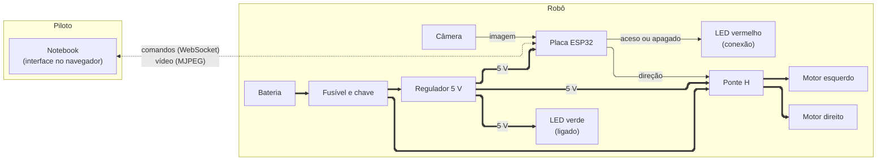

# Arquitetura

Como as partes do Balloone se ligam. O funcionamento da rede está em [`rede/README.md`](rede/README.md), e os detalhes elétricos, no [esquemático](../eletronica/esquematico-eletronica.pdf).

## Diagrama de blocos

- **Linha grossa:** energia.
- **Linha fina:** sinal elétrico.
- **Linha tracejada:** Wi-Fi. Os comandos vão do notebook para a placa, e o vídeo volta da placa para o notebook.

Para mudar o diagrama, edite o texto do bloco `mermaid`. Dá para testar antes em [mermaid.live](https://mermaid.live).

## Em aberto

- **Proteção da bateria:** não há placa de proteção (BMS) para as duas células.
- **Parada garantida:** se o firmware travar, nada desliga os motores.
- **Rede da competição:** hoje a placa cria a própria rede. Um roteador central ainda está em avaliação.
